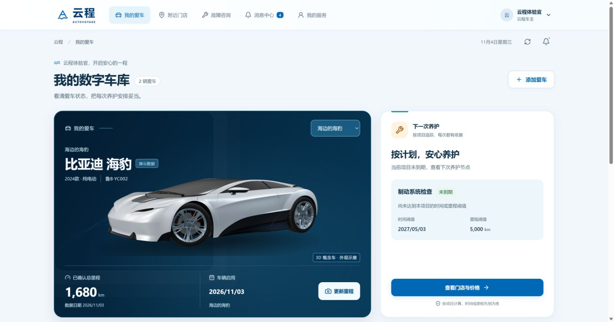

# 云程 AutoVoyage

中国海洋大学 MEM《软件工程管理》课程项目：汽车信息管理系统。

React + TypeScript 车主 H5 / 管理 Web，Node.js + Fastify 统一 API，PostgreSQL 持久化。支持通用服务项目选择导入、AI直接读取手册并展示保养周期表、保养表图片识别、AI 预填与一次确认导入，以及近年车系的实际年款、动力与配置选择。沿用自动系统更新日志、银白概念跑车和海洋蓝主题，覆盖行驶证建档、车辆档案、保养提醒、门店比价预约、故障咨询与服务记录。

课程预览已部署：[打开云程](http://117.72.124.241:58083/)。车主、门店、专家和平台账号的独立口令保存在部署者本机受控文件中，不提供公开通用密码。实际验收范围见 [验证记录](docs/verification.md)。



首页截图保留 V0.5 公网验收，V0.6 沿用该视觉和课程演示车辆。车辆视觉由授权 Car Concept 模型离线渲染，网页只加载静态 WebP；外观仅为示意，作者、CC BY 4.0 许可与修改说明见 [素材来源](docs/image-attribution.md)。文档中的 [门店地图截图](docs/images/store-map.png) 沿用 V0.4，该页面视觉本轮未改。

海洋蓝取自中国海洋大学海洋文化的设计灵感，色值为项目自定配色。

## 功能与当前进度

**当前运行V0.9.7 `0.9.7+8054761a75`，已于2026-11-12北京时间00:22:11上线。** PR #1与PR #2均已合并，保留记住账号、手工里程与历史保养补录、门店成员和首次改密、AI最近结果回看、手工保养表等功能，并修复V0.9.6在IP加HTTP环境打开手工表格白屏的问题。238项完整检查通过；本轮后端30项PostgreSQL隔离专项在V0.9.6整合时通过，V0.9.7仅修复前端兼容。公网已复测打开表格、增加第2行和更新日志当前版本，取消表格未保存；本轮没有新AI查询或生产样例草稿写入。详见[团队PR整合与HTTP修复](docs/team-pr-update.md)、[HTTP手工表格](docs/images/team-v097-manual-cloud.png)、[容器健康](docs/images/team-v097-stack-cloud.png)及[完整验证记录](docs/verification.md)。

**历史V0.9.5于2026-11-08北京时间00:00:33上线，当时运行`0.9.5+32708cee9c`。** AI查找默认展示常规使用下的主要保养项目与官方要求，特殊工况和完整细分条目按需展开，带入仅选主要常规规则。该版全新公网汉兰达查询显示9项常规大项，41条特殊工况及全部99条细目默认收起；该轮仅查询，未导入或发布样本。[简表截图](docs/images/manual-v095-result-cloud.png)、[油液与精简导入](docs/images/manual-v095-result-lower-cloud.png)已归档。具体范围见[常规保养摘要](docs/common-maintenance-summary.md)，完整验收见[验证记录](docs/verification.md)。

**历史V0.9.4于2026-11-07北京时间23:11:42上线，当时运行`0.9.4+98079fdcf4`；该版全新公网AI查询实际读取汉兰达官方手册并返回103项待核对候选。** 该版修复“官网有手册，但搜索返回无关结果，流程在AI之前结束”的问题：广汽丰田资料从官网实际加载的目录数据中取得PDF，按年款和动力筛选，不用版本日期猜年款或补造具体配置；开放检索继续保留。失败信息区分检索、下载、选页与AI整理，检索异常不等于没有公开手册。AI查找仅对指定广汽丰田官方PDF路径允许读取96 MiB文件，其他网址默认32 MiB，上传限制保持不变；最多12个证据编号，较多页时按单个目标页分段整理并保留所选章节、图例与脚注上下文，整章合并及人工补充最多120项。成功后可一键带入待核对草稿，再由人工确认发布，查询不写业务库。实现边界见 [手册导入](docs/manual-import.md) 与 [API](docs/api.md)，实际发布另见 [验证记录](docs/verification.md)。

通用分段整理、失败阶段诊断和提取提示适用于各来源；**官方动态目录直连目前只覆盖广汽丰田**。其他品牌继续开放检索，仍可能遇到下载限制或没有可读取原文，本次未逐一实测其他车型，不能据此认为所有品牌都已解决或保证查询成功。手头已有手册图片时可直接上传识别，不依赖网站检索，仍需核对清晰度和车型适用性。

| 使用角色 | 主要功能 |
| --- | --- |
| 车主 | 多车档案、行驶证识别与人工核对、仪表里程识别或手工更新、历史保养补录、分项目保养提醒、门店查询与比价预约、故障咨询、消息及服务记录 |
| 门店管理员 | 本店资料、服务报价与版本、时段名额、预约接单及服务进度、项目与费用变更、咨询回复或专家分配、本店成员开通与停用 |
| 门店专家 | 分配范围内的故障资料、补充信息、建议与费用预估 |
| 平台管理员 | 公开品牌／车系、实际年款／动力／配置及参考服务项目选择导入、标准项目、AI查找手册／图片识别／手工表格及核对导入、最近AI结果回看、按车型查看保养规则与资料、门店审核及审计记录 |
| 全部已登录角色 | 系统更新日志、当前运行版本与首次上线时间 |

平台管理员从“车型档案 → 从公开车型库选择”与“标准服务项目 → 从参考项目库选择”进入预置目录。车型可先按实际年款筛选，默认只显示有公开配置的车系；卡片逐项显示已收录年份，再按动力选择完整配置导入。未收录不等于该年款不存在，可依据实车资料手动补充。已上线V0.9.2的服务参考库为27项：在原25项基础上补充独立的“更换发动机机油”和“更换发动机机油滤清器”，不再要求把两个不同周期合成一个服务。参考库扩充不会自动增加正式业务项目，可按需选择导入；手册中的参考关联仅在确认发布所选行时创建或复用。业务列表默认显示启用项，支持已停用／全部及分类筛选，停用项目可编辑恢复。导入保留已有编辑、跳过不明确冲突并显示原因。当前上线版本、容器状态、测试和截图以 [验证记录](docs/verification.md) 为准；文档提交不触发 Portainer 自动发布。

初始课程数据包括迈腾、海豹演示车型，以及演示规则、门店、价格与记录；公网后来新增的业务资料在本次更新中保留。当前公开候选目录预置 **3,829 个车系名称、36,754 条完整配置和 27 个通用服务项目**；候选数量不等于正式业务库的数量。有配置的车系共2,390个、涉及221个品牌名称。V0.8.1 新增7,573条来源配置，2020年以后共7,520条，覆盖1,000个车系、126个品牌；其中2024款2,600条、2025款2,018条、2026款150条。海狮06已有2025款6条、2026款9条；迈腾、凯美瑞、理想、问界及其他近年车系均有来源记录。原MIT历史数据仍明确为1999–2019年款，不能将大批历史记录等同于近期覆盖。各来源仍有年款断档，不代表全品牌、全配置或全部当前在售；只有选择后才导入业务档案，保养范围仍待手册核对。许可、清洗及实际年份见 [现代数据](docs/vehicle-variants-modern.md)、[比亚迪补充](docs/vehicle-variants-byd-recent.md)、[热点车系](docs/vehicle-variants-latest.md)。

V0.8.6 将此前120项参考目录收敛为25项通用保养候选，保留来源及历史ID兼容。细分维修不再出现在参考选择列表；已有启用业务项目仍可用于手册关联，无法匹配时留空。最初通过只读预览、快照及事务停用旧细分项目，随后按用户要求清空重建为25项通用业务项目；两种维护流程均见 [公开目录](docs/public-catalog.md)。服务名称不自带周期、价格或车型关系，来源见 [来源说明](docs/public-catalog-sources.md)。

车主与管理端均可打开“系统更新日志”。构建自动生成 `基础版本+源码摘要` 版本，API 首次成功监听时写入数据库；相同构建重启、回滚复用原记录。发布者可维护 `release.config.json` 中的功能说明；没有新说明的源码更新也会按变更模块生成摘要。机制、编辑步骤及接口见 [系统更新日志](docs/system-releases.md)。

当前运行 **V0.9.7 `0.9.7+8054761a75`**，发布源码为`e3b539a3a5c09370e0892c10e2cd8664d00ad935`，首次成功启动`2026-11-11T16:22:11.135Z`（北京时间2026-11-12 00:22:11）。API `autovoyage-api:e3b539a`（`8c53cd033175`）、Web `autovoyage-web:e3b539a`（`42db96282485`）均healthy，四条公网路径均HTTP200；17项私有环境变量一致，Compose只替换两个镜像标签。部署前备份public中23张自有表、519行；上线后21张业务／审计／缓存表逐值一致，13条旧发布记录保留并新增本版1条，共14条，最近AI结果缓存仍为0行。6车型、27项启用项目、19规则、30文件、6份手册任务、12份报价及12份历史版本、2条保养记录保留。最终源码的[main CI](https://github.com/gexiaobin/mem-car-information-system/actions/runs/43057490321)及[开发分支CI](https://github.com/gexiaobin/mem-car-information-system/actions/runs/43057489475)成功。V0.9.6的HTTP白屏已在本版实际公网入口复测修复，失败历史保留；优先回滚稳定V0.9.5标签`48f12c1`，不推荐有已知白屏的V0.9.6。完整证据与回滚步骤见[验证记录](docs/verification.md)及[部署说明](docs/deployment.md)。

历史版本 **V0.9.5 `0.9.5+32708cee9c`**，发布源码为`48f12c1fcf71649dacfb333a58c667dfb4e3a56c`，首次成功启动为`2026-11-07T16:00:33.988Z`（北京时间2026-11-08 00:00:33）。API `autovoyage-api:48f12c1`（`27c304ca31c0`）、Web `autovoyage-web:48f12c1`（`5518d911a4a7`）；四条公网路径均HTTP200，数据库`postgres`、`demoMode=false`。17项私有环境变量逐项一致，Compose仅替换两个镜像标签，数据库、上传卷、网络、API 1 GiB及58083端口沿用。部署前于`2026-11-07T16:00:16.160Z`只读备份public中22张自有表、443行；上线后20张业务／审计表内容逐值一致，旧11条发布记录保留，仅新增本版1条，共12条。6车型、27项启用标准项目、12规则、1条真实保养记录、17文件、5份手册任务及9份报价／9份版本保留。220项测试、完整类型／构建检查及18项隔离PostgreSQL专项通过，发布源码两分支CI均成功。旧91项真实响应本地整理得到9个主要项目、10条原始规则，仅作为既有响应的摘要验证；该版公网查询验收见[验证记录](docs/verification.md)。该次镜像回滚目标为V0.9.4 `243540a`，详见[部署说明](docs/deployment.md)。

历史版本 **V0.9.4 `0.9.4+98079fdcf4`**，发布源码为`243540a6b73e237b3e711f1e30af9cf40249b8ad`，首次成功启动为`2026-11-07T15:11:42.029Z`（北京时间23:11:42）。API镜像`a891035e0bb6`、Web镜像`418de8cec972`，标签均为`243540a`；四条公网路径均HTTP200。17项私有环境变量原样保留，Compose仅替换两个镜像标签，数据库、上传卷、网络、API 1 GiB及58083端口沿用。该次部署前备份public中22张自有表、442行，上线后20张业务／审计表内容逐值一致；旧10条发布记录保留，仅新增该版1条，共11条。6车型、27项启用标准项目、12规则、1条真实保养记录、17文件、5份手册任务及9份报价保留。本地十次真实单页AI调用成功，最终解析原响应重放得到91项partial候选；随后该版全新公网查询完成，读取《2024款汉兰达汽油版用户手册-2405版（01999-0E202）》，返回103项候选及32项原文说明／待核对事项，界面显示“已读取手册·部分要求待核对”。具体配置适用性及候选仍需人工核对，未逐项审核全部103项，也未导入或发布查询样本。[该版公网结果截图](docs/images/manual-v094-result-cloud.png)及完整证据见[验证记录](docs/verification.md)。

历史版本 **V0.9.3 `0.9.3+5907628593`**，于2026-11-07北京时间21:48:35首次成功上线，发布源码为 `e9a9b35ee7b9a12117673b402f5c13bfdb6a9c0a`。API／Web均healthy，四个公网入口均HTTP200；17项私有环境变量、数据库、上传卷、网络、API 1 GiB及58083端口沿用。最终部署前备份22张自有表、439行；上线后20张业务／审计表逐对象一致，旧9条发布记录保留，仅新增该版1条，共10条。正式项目27项全部启用，12规则、5车型、2辆车、9份报价及9份版本、1条保养记录、5份手册和17个文件保留；这些项目与规则已在该次部署前基线中，升级未自动扩充业务目录或发布手册。首次部署曾因共享包运行时加载失败而回滚，修复内联打包并增加Windows／Linux原生Node产物启动检查后重新部署成功，失败与恢复过程完整保留在 [验证记录](docs/verification.md)。最终167项测试、全项目类型检查、两端构建及27项真实PostgreSQL专项通过；发布源码的[main检查](https://github.com/gexiaobin/mem-car-information-system/actions/runs/42378270323)与[开发分支检查](https://github.com/gexiaobin/mem-car-information-system/actions/runs/42378270167)均成功。该次镜像、回滚和保留核验见 [部署说明](docs/deployment.md)。

V0.9.3公网证据：[条件项目月份与公里](docs/images/maintenance-v093-time-fields-cloud.png)、[按车型查看时间规则](docs/images/maintenance-v093-rules-cloud.png)、[该版更新日志](docs/images/maintenance-v093-updates-cloud.png)、[两容器健康](docs/images/maintenance-v093-stack-cloud.png)。

V0.9.3已上线。它补齐时间与里程的表达和提醒：固定周期可只有月数、只有公里数或两者先到；条件项目显示并保留四个原文阈值，仅在人工确认可独立触发，或严格符合“警告或6个月／1年”原文证据时纳入计算，严苛工况及多版本适用条件继续按条件处理。旧机油／机滤资料可按证据动态兼容，无需批量改库；明确关闭独立阈值时不计算。车主首页和列表增加到期日期及按北京时间计算的剩余／逾期天数，同状态优先较早日期；时间临近提醒保留缺里程提示，车型依据也展示条件内原文数值。普通规则可完整编辑时间与里程，已发布手册规则仍需新版本资料修订。操作与接口见 [手册导入](docs/manual-import.md)、[用户手册](docs/user-guide.md) 和 [API](docs/api.md)。具体隔离验证、初次部署失败及最终上线证据见 [验证记录](docs/verification.md)。

历史版本 **V0.9.2 `0.9.2+3e822546b3`**，于2026-11-07北京时间20:41:55上线，发布源码为 `b082863e102087d3f81df7c31fc9785be2426f65`。API／Web均healthy，四个公网入口均HTTP200，旧8条更新日志保留并新增本版1条。部署前备份22张自有表、422行；部署后20张业务／审计表逐对象一致。随后仅为正式思域29行待核对草稿执行一次重新关联，已关联5→7，新增机油／机滤两处参考关联，6／12个月、条件与默认未选状态保持，仍有22行待处理，未发布规则。除该草稿修订及一条关联审计外其余数据核验一致：正式项目仍25项全部启用，5车型、7规则、2辆车、9份报价及9份报价版本、1条保养记录、4份手册和14个文件保留。17项私有环境变量、数据库、上传卷、网络与58083端口沿用。完整检查（158项测试）及22项真实PostgreSQL专项通过；发布源码的[main检查](https://github.com/gexiaobin/mem-car-information-system/actions/runs/42373092256)与[开发分支检查](https://github.com/gexiaobin/mem-car-information-system/actions/runs/42373092242)均成功。公网证据：[独立项目关联](docs/images/manual-v092-matching-cloud.png)、[更新日志](docs/images/manual-v092-updates-cloud.png)、[两容器健康](docs/images/manual-v092-stack-cloud.png)；完整记录见 [部署说明](docs/deployment.md) 和 [验证记录](docs/verification.md)。

历史版本 **V0.9.1 `0.9.1+b493fefab7`** 于2026-11-07北京时间19:34:30上线，发布源码为 `038166f9ab6a81b8797c9af2bc98344b09c0ccdc`。AI查找会直接读取取得的真实手册原文，展示原文链接及保养周期表，已整理结果可直接进入核对；目录或网盘不视为已取得手册。API／Web均healthy，四个公网入口均HTTP200，自动新增1条本版更新日志，旧7条记录保留。部署前备份22张自有表、415行；该次上线后20张业务／审计表逐对象一致，25项服务全部启用，5车型、7规则、2辆车、9份报价及9份报价版本、1条保养记录、3份手册和11个文件完整保留。17项私有环境变量、数据库、上传卷、网络与访问端口沿用，完整部署证据见 [部署说明](docs/deployment.md) 和 [验证记录](docs/verification.md)。

V0.9.1公网已对2025款思域汽油1.5T CVT执行真实AI查询：取得2份可阅读的官方资料入口（同册保养表与首页），展示29个保养项目的首次／后续周期、条件和原文摘录，并提供“带入核对”入口。原文适用范围为2025款三厢汽油版，未明确到排量、功率及CVT配置，页面继续提示核对；本轮仅查询，未带入或发布正式规则。[官方资料与查询概况](docs/images/manual-v091-manuals-cloud.png)、[AI保养周期表](docs/images/manual-v091-answer-cloud.png)、[更新日志](docs/images/manual-v091-updates-cloud.png)、[容器健康](docs/images/manual-v091-stack-cloud.png) 已归档；发布源码的[GitHub Actions检查](https://github.com/gexiaobin/mem-car-information-system/actions/runs/42368627423)在main与开发分支均通过。

历史版本 **V0.9.0 `0.9.0+88ff2b9bb5`** 于2026-11-07北京时间16:39:16上线。API／Web均healthy，四个公网入口均HTTP200，自动新增1条本版更新日志。公网已验证AI查找／图片识别两入口、雅阁仅4条规则、旧手册可查看，以及从车型档案直接进入海豹的1条规则。雅阁开放查询返回5份具体候选和3个目录，AI整理完成，年款动力仍待核对；该轮未识别导入或发布正式保养资料。部署前备份与上线后逐对象核验确认既有25项启用服务、5车型、7规则、2辆车、3份手册、11个文件及保养记录完整保留。源码已同步main和开发分支；[公网导入工作区](docs/images/manual-v090-entry-cloud.png)、[按车型规则](docs/images/manual-v090-rules-cloud.png)、[开放查询](docs/images/manual-v090-search-cloud.png)、[更新日志](docs/images/manual-v090-updates-cloud.png)、[容器健康](docs/images/manual-v090-stack-cloud.png)，详见 [验证记录](docs/verification.md)。

历史版本 **V0.8.6 `0.8.6+1fecfe24f9`** 于2026-11-07北京时间15:11上线。随后按用户要求，于北京时间15:40执行正式目录重建：**旧123项全部清除，重新导入25项通用标准服务，25项启用、0项停用**。可等价的规则、报价和保养记录迁移保留；获准清理2条演示规则、12条演示报价及12条历史报价版本。5个车型、2辆车、3份手册、11个文件和1条保养记录保留；2行未选检查草稿解除关联并保留原文。该次为数据维护，无需重新部署，也未新增软件发布日志；正式库逐对象比对、幂等及公网验收已通过，见 [重建列表](docs/images/general-service-reset-cloud.png) 和 [完整验证记录](docs/verification.md)。

V0.8.6发布时的历史验收为30项启用、93项停用，112项完整回归、32项目录／手册及5项精简执行器真实PostgreSQL专项通过，API／Web均healthy，自动新增本版更新日志。历史证据保留：[精简后的列表](docs/images/common-service-simplified-cloud.png)、[25项通用库](docs/images/common-service-general-catalog-cloud.png)、[更新日志](docs/images/common-service-simplified-updates-cloud.png)。重建执行器另经116项完整回归、PGlite与真实PostgreSQL各4项专项以及535行正式备份全量隔离演练验证。

历史版本 **V0.8.5 `0.8.5+2be7c67710` 已于2026-11-05北京时间19:20上线**。当时参考目录120项、13分类，正式补入后业务目录123项；V0.8.6上线时先通过停用精简，后于2026-11-07按用户要求清空重建为上述25项。保留历史验收：[正式补入截图](docs/images/common-service-import-cloud.png)、[分类列表](docs/images/common-service-projects-cloud.png) 与 [更新日志](docs/images/common-service-updates-cloud.png)。

历史版本 **V0.8.4 `0.8.4+22d57176e5` 已于2026-11-05北京时间18:43上线**：手册草稿可按原文批量补全空白首次保养、自动关联已有或参考标准项目，并按车型整理真实公开手册候选；车型卡片支持查看本车型规则和删除未被引用的条目。101项回归、真实PostgreSQL专项及真实公开检索／AI排序验证通过，两容器均healthy，原业务数据核对保留，自动生成本版更新日志。已有首次值、人工映射及业务引用保留，查询不会自动生成或发布保养周期。公网汽油版凯美瑞查询中出现双擎手册候选，页面明确年款动力尚未确认，不能当作适用手册。使用方式与限制见 [手册导入](docs/manual-import.md)；公网证据：[车型规则筛选](docs/images/manual-model-rules-cloud.png)、[AI候选查询](docs/images/manual-ai-search-cloud.png)、[更新日志](docs/images/manual-tools-cloud-updates.png)，详细结果见 [验证记录](docs/verification.md)。

V0.8.3 历史版本 `0.8.3+2a620a9098` 于2026-11-05北京时间16:02上线，修复车型维护的保养项目复选框布局，功能在当前版本保留。该次全项目类型检查、86项测试与两端构建通过；[公网修复截图](docs/images/model-maintenance-fixed.png)。手机断点仅完成静态审查，未记为手机浏览器实测通过；详细结果见 [验证记录](docs/verification.md)。

V0.8.2 历史版本 `0.8.2+8f8553a803` 于2026-11-05北京时间15:39上线，包含V0.8.1近年配置和快捷图片导入，功能在当前版本中保留。该次发布前通过86项测试、20项真实PostgreSQL手册专项，以及合成保养表的真实AI与浏览器验收。公网证据：[图片导入入口](docs/images/manual-quick-cloud.png)、[自动更新日志](docs/images/manual-quick-cloud-updates.png)；隔离本地证据：[AI自动填写草稿](docs/images/manual-quick-ai-review.png)、[手机图片入口](docs/images/manual-quick-mobile.png)。

V0.9.1将AI查询改为直接读取真实原文、展示手册链接与保养周期表，结果可直接带入核对，不重复下载和识别；目录与网盘不作为已取得手册。已验证2025思域官方电子手册及关键周期，原文不明确的配置和项目关联仍需核对。具体边界及最新上线状态见 [手册导入](docs/manual-import.md) 和 [验证记录](docs/verification.md)。

V0.9.2将“原文已识别”“标准项目已关联”“本次是否导入”分别展示；旧的待核对草稿可直接使用“重新自动关联标准项目”，无需重跑AI。关联只接受确定的同义名称、同部件、同动作和唯一目标，保留人工选择；多动作、重复目标、停用或歧义会说明原因。条件项目默认不选，核对后可选入，原文阈值仅在其条件下适用，不强行转为固定到期提醒。详见 [手册导入](docs/manual-import.md)。

V0.9.0起的导入工作区主界面只保留 **AI查找手册** 和 **图片识别**，规则、资料与历史统一跟随当前车型。查询按品牌和车系开放搜索通用保养手册／周期表，优先官方资料，具体资料与目录入口分开展示；“通用候选”不代表适用于全部年款和动力。名称、版次、适用说明和项目由AI依据原文预填，可选信息未注明时留空。核对后一个按钮保存当前编辑并导入；问题集中显示并可定位，不再先保存再重复勾选确认。

推荐操作：**选车型 → AI查找手册或上传／粘贴保养表截图 → 核对项目 → 一次确认导入**。规则只显示当前车型；详细信息按需展开，无法确定的标准项目继续留空，检查与更换保持区别。旧PDF任务仍可查看，新入口无需手动选页或填写链接。本地完整检查131项、真实PostgreSQL手册专项25项通过，手机和桌面多宽度无横向溢出；真实AI合成图片已验证自动预填、集中定位问题、排除异常项及修改后直接一次发布，全程仅写独立内存库。[开放查找本地截图](docs/images/manual-v090-open-search-local.png)、[手机本地截图](docs/images/manual-v090-mobile-local.png)、[图片一次发布本地截图](docs/images/manual-v090-image-published-local.png)。操作与实际发布状态见 [手册导入](docs/manual-import.md) 和 [验证记录](docs/verification.md)。

## 文档导航

| 文档 | 内容 |
| --- | --- |
| [操作手册](docs/user-guide.md) | 登录、车辆建档、行驶证上传、里程更新、预约与课程演示步骤 |
| [系统架构](docs/architecture.md) | 前后端、数据模型、权限、事务、AI 与 Docker 网络 |
| [配置说明](docs/configuration.md) | 本地 / PostgreSQL / AI / 地图 / 服务器环境变量及常见问题 |
| [API 接口](docs/api.md) | 路由、权限、请求示例、行驶证字段与状态 |
| [保养手册导入](docs/manual-import.md) | AI开放查找／图片识别、自动预填、按车型查看、一次确认导入与资料边界 |
| [公开车型与服务目录](docs/public-catalog.md) / [资源来源](docs/public-catalog-sources.md) / [配置来源](docs/vehicle-variants-sources.md) | 预置候选、年款动力配置筛选与导入、批量项目、数据年代与许可 |
| [系统更新日志](docs/system-releases.md) | 自动版本标识、上线记录、发布说明维护、重启与回滚 |
| [部署说明](docs/deployment.md) | 京东云、Portainer、端口、初始化、升级与回滚 |
| [六人协作与验收](docs/development.md) | 分工、迭代、提交约定、测试与演示交付 |
| [V0.9.6–V0.9.7团队PR更新](docs/team-pr-update.md) | PR #1／#2整合范围、账号与成员、手工保养表、历史记录及验收清单；实际合并与部署状态见验证记录 |
| [验证记录](docs/verification.md) | 已执行结果、当前线上版本与后续验收边界 |
| [设计规范](design-system/autovoyage/MASTER.md) / [图片署名](docs/image-attribution.md) | UI 设计约定、照片作者、来源及许可 |

## 本地运行

推荐 Node.js 24 和 npm（Docker 与 CI 均使用 Node.js 24）。以下命令在项目根目录执行：

```bash
git clone https://github.com/gexiaobin/mem-car-information-system.git
cd mem-car-information-system
npm ci
```

首次运行复制 `.env.example` 为 `.env`：Windows PowerShell 执行 `Copy-Item .env.example .env`，macOS / Linux 执行 `cp .env.example .env`。已有 `.env` 时保留自己的配置；本地开发至少将 `SESSION_SECRET` 换成自己生成的 32 字符以上随机值。保留默认 PGlite 可直接体验演示数据。

```bash
npm run dev
```

打开 http://localhost:5173 。前端通过 Vite 代理访问 API，后端默认监听本地 3001。开发默认使用 PGlite（本地运行的 PostgreSQL 引擎，数据保存到 .local），无需安装数据库；也可将 `DATABASE_DRIVER` 改为 `postgres` 连接指定 PostgreSQL。

前端支持热更新。修改后端后需重启开发命令；连接真实 PostgreSQL 时也可单独运行 `npm run dev:watch -w @autovoyage/api`。Windows/OneDrive 下不建议对持久化 PGlite 使用强制重启监视，以免数据库未正常关闭。

仅本地演示环境会显示演示账号。默认邮箱 `owner@autovoyage.demo`、`store@autovoyage.demo`、`expert@autovoyage.demo`、`admin@autovoyage.demo`，分别对应车主、门店、专家和平台。初次种子的密码由 `DEMO_PASSWORD` 设置；修改环境变量不会自动重置已存在账号。示例密码仅用于本地开发，不能沿用于公网部署。

## 行驶证识别怎么使用

1. 新车：车主首页 → **添加爱车 → 行驶证识别建档**。已有车辆：**我的服务 → 车辆档案 → 上传行驶证并识别**。
2. 选择行驶证正页照片（JPEG / PNG / WebP，最大 8 MB），明确同意发送至已配置的 AI 服务后上传。
3. 核对车牌、车辆类型、所有人、使用性质、品牌型号、VIN、发动机号码、注册日期、发证日期，可逐项修改。
4. 新车需另选平台已有的准确保养车型，填写昵称、车辆启用日期与启用时里程；勾选核对确认后保存。

上传与识别不会直接修改车辆；行驶证不提供当前里程，不替代仪表里程更新。已有车辆补证须与原车牌匹配，保留原车型和里程基准。照片与证件字段仅本人可见，本流程不提取住址字段；原图仍可能含住址，上传前可自行遮挡无关信息。详细步骤与失败处理见 [操作手册](docs/user-guide.md)。

## 开发命令

| 命令 | 用途 |
| --- | --- |
| `npm run dev` | 同时启动本地前端与 API |
| `npm run typecheck` | 全项目 TypeScript 检查 |
| `npm test` | 后端回归，使用隔离数据和合成 AI 响应；具体项数以当次输出为准 |
| `npm run build` | 构建 API 和 Web 生产产物 |
| `npm run check` | 依次执行类型检查、测试与构建；GitHub Actions 同样执行 |
| `npm run test:postgres` | 7 项真实 PostgreSQL 交易联调，只操作新建的临时 schema |

行驶证的 6 项真实 PostgreSQL 测试启用方式见 [六人协作与验收](docs/development.md)。真实 AI 请求与真实 PostgreSQL 验证不属于默认 CI 的外部依赖；CI 通过不代表真实照片准确率或公网部署已通过验收。

`npm run build` 会将本次源码版本嵌入 API；仅构建不会写入系统更新日志。源码或 `release.config.json` 变化后，应重新构建并部署 API 与 Web，启动成功后自动登记。完整发布流程见 [系统更新日志](docs/system-releases.md) 与 [部署说明](docs/deployment.md)。

## 接入真实服务

- PostgreSQL：在未跟踪的 `.env` 填写 `PGHOST`、`PGPORT`、`PGDATABASE`、`PGUSER`、`PGPASSWORD`，设 `DATABASE_DRIVER=postgres`。开发联调使用预先创建的 `PGSCHEMA=av_development`，与公共预览使用的 public schema 分开。应用只维护指定 schema 内 `av_` 前缀的自有表，不清空原数据库。真实 PostgreSQL 事务验证命令为 `npm run test:postgres`，只使用其新建的临时 `av_test_*` schema。
- 图片识别：填写 `AI_BASE_URL`、`AI_MODEL`、`AI_API_KEY`。通过 `AI_API_STYLE=responses` 接入 Responses 视觉服务，或保留默认 `chat_completions` 兼容原接口；`AI_BASE_URL` 填 API 根地址（通常以 `/v1` 结尾），请求超时由 `AI_TIMEOUT_MS` 设置（默认 90000 毫秒，范围 1000–180000）。未配置时会保存受控上传并明确报告识别不可用，不生成候选里程。
- 地图：`MAP_PROVIDER=osm` 使用 MapLibre GL 与 OpenFreeMap 提供的 OpenStreetMap 矢量底图，无需 Key，保留地图署名。浏览器需要 WebGL 和对地图样式、字体、瓦片的网络访问；加载失败可重试并继续使用门店列表。中国大陆正式接入可配置 `MAP_PROVIDER=amap` 和高德 `AMAP_WEB_KEY`、`AMAP_SECURITY_CODE`，按服务商要求配置实际访问来源与额度。
- 部署：本阶段按用户选择先不用域名，使用 `compose.preview.yml` 提供 58083 端口的 HTTP 课程预览；部署是否完成以验证记录为准。`compose.yml` 保留为以后复用 Nginx Proxy Manager 的 HTTPS 方案。公共 IP 的 HTTP 预览不能代替要求安全上下文的浏览器定位及 HTTPS 安全会话验收；无定位时仍可手选搜索中心。

`.env`、私人上传图片、数据库文件、密钥及服务器账号不会进入 Git。V0.3 移除车型照片资源，保留 [历史图片署名](docs/image-attribution.md)。演示车型、手册周期、门店、价格与记录明确标识，不能用作真实车辆的保养依据。

## 项目结构

```text
apps/api/                     Node.js API、数据库、业务规则与测试
apps/web/                     React 车主端与管理端
packages/shared/              共享类型与金额/状态显示
design-system/autovoyage/      设计规范、语义样式变量、页面规范
deploy/                       Dockerfile、Nginx 配置
release.config.json           发布版本、标题与人工功能说明
scripts/release-manifest.mjs   可用于无 Git 源码包的版本摘要生成器
compose.yml                   复用既有数据库与代理网络的部署配置
compose.preview.yml           无域名的 IP + 58083 HTTP 课程预览配置
docs/                         接口、部署、分工与验收记录
```

## 业务约束

预约将本人车辆校验、价格版本/有效期检查、时段余量、车辆时间冲突、名额占用和价格快照放在同一事务，重复请求具有用户级幂等语义。取消、拒绝和超时关闭只释放一次名额。费用变更必须先经车主同意，完工确认只更新实际完成的保养项目。

图片中的值在车主核对、质量校验成功后才成为有效观测。失败、旧图、重复图、未来日期或里程回退不会静默覆盖有效记录。故障预估与固定总价明确区分，地图中的演示门店不代表真实商家。

部署步骤见 [部署说明](docs/deployment.md)，六人协作建议见 [开发与验收](docs/development.md)，接口见 [API](docs/api.md)。实际已验证内容与尚待接入项在 [验证记录](docs/verification.md) 中记录。
