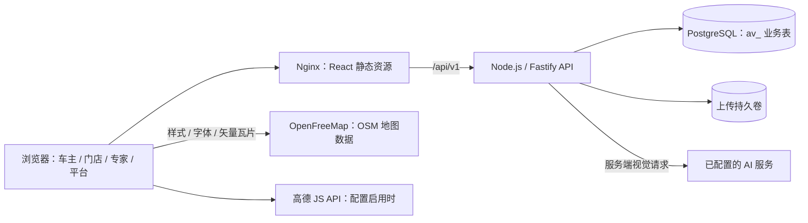
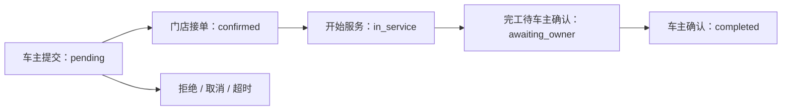
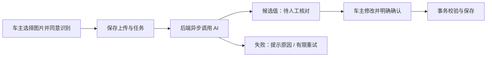

# 云程 · 系统架构与数据设计

本文对应当前课程 MVP 的实际代码，便于组员说明“系统如何组成、数据如何保存、哪些规则由谁保证”。接口字段见 [API 文档](api.md)，部署命令见 [部署说明](deployment.md)，实际执行结果见 [验证记录](verification.md)。

V0.3 调整车主视觉与地图加载：车型展示采用项目原创 SVG 示意，默认地图改用 MapLibre GL 渲染 OpenFreeMap 提供的真实 OSM 矢量底图。具体发布版本及已通过的检查以验证记录为准，不将开发实现视为已经上线。

## 1. 技术架构

系统采用一个仓库、一个 React 应用、一个 Node.js API 和一个 PostgreSQL 数据库。车主使用响应式页面，门店、专家和平台使用同一前端中的角色工作台；登录后由角色决定页面及允许操作，服务端再次校验权限。

| 部分 | 当前实现 | 主要位置 |
| --- | --- | --- |
| 前端 | React 19、TypeScript、Vite、React Router；MapLibre GL 地图、Lucide 图标 | `apps/web/` |
| 后端 | Node.js 24 Docker 运行时、Fastify 5、Zod 参数校验、Sharp 图片处理 | `apps/api/` |
| 数据访问 | `pg` 连接真实 PostgreSQL；PGlite 用于本地开发和内存测试 | `apps/api/src/db.ts` |
| 共享契约 | 角色、车辆、报价、预约、识别任务等 TypeScript 类型 | `packages/shared/` |
| UI 规范 | 色彩、排版、间距和页面设计说明 | `design-system/autovoyage/` |
| 构建交付 | npm workspaces、API esbuild、Web Vite、Docker 多阶段构建 | `package.json`、`deploy/` |
| 持续检查 | GitHub Actions 执行依赖安装、类型检查、测试和生产构建 | `.github/workflows/ci.yml` |

本地 Vite 将 `/api` 代理到 `127.0.0.1:3001`；生产环境由 Nginx 提供前端并代理同源 API，前端不直接连接数据库或持有 AI 密钥。

默认 OSM 选项由 MapLibre GL 在浏览器通过 WebGL 渲染；样式、字体和矢量瓦片直接从 OpenFreeMap 公开服务获取，无需 API Key。地图保留数据源自动提供的署名，不使用 OSM 标准栅格瓦片或 `/map-tiles/` 代理。前端显示加载与失败状态并提供重试，门店列表独立可用。可用性依赖用户浏览器的 WebGL 支持、网络和公开地图服务，目标环境的实际结果见验证记录；高德 JS API 保持单独的配置与浏览器加载路径。

门店数据明确标记 WGS84 或 GCJ02 坐标系；OSM 以 WGS84 展示，高德入口转换为 GCJ02，搜索中心和直线距离计算统一使用 WGS84。地图点位与列表使用同一组已筛选门店，不用示意图替代真实地理底图。

登录、车主首页和车辆档案共用原创 SVG 汽车插画。插画表达汽车与动力类型的视觉主题，不复刻特定车型外观，也不作为车辆配置、年款或所有权证明；真实车型选择与保养规则仍由车辆档案决定。

## 2. 数据保存方式

当前业务实体采用 PostgreSQL 的 **`id text PRIMARY KEY + data jsonb`** 结构，`data` 必须是 JSON 对象。它便于课程迭代时统一读写共享类型，但并非每个字段都已经拆成关系型列。业务实体间的 ID 关联多数由应用校验；不能将下表解释为所有关系都已建立数据库外键。

| 业务组 | 实际表名（均带 `av_` 前缀） | 主要关联 |
| --- | --- | --- |
| 身份与会话 | `users`、`sessions` | 会话关联用户；`sessions` 为独立列结构，`user_id` 有用户外键 |
| 车辆与保养资料 | `models`、`projects`、`rules`、`vehicles` | 车辆关联车主和具体车型；规则关联车型及标准项目 |
| 门店与报价 | `stores`、`offers`、`offer_versions`、`slots` | 报价关联门店、车型和项目；时段关联门店 |
| 服务过程 | `appointments`、`changes`、`records` | 预约关联车辆、车主、门店及时段；变更关联预约；档案按实际完成项目记录 |
| 故障与消息 | `faults`、`messages`、`logs` | 故障关联车辆、门店及被分配专家；消息属于接收人；日志记录操作主体与对象 |
| 图片与识别 | `files`、`imports`、`registration_imports`、`observations` | 图片归属上传者；里程任务关联车辆；行驶证任务在确认前可尚未关联新车辆 |

数据库已建立的关键约束包括：用户邮箱忽略大小写唯一；同一车主的预约请求标识唯一；同一预约、同一保养项目的服务记录唯一；同一识别任务只能形成一份里程观测；时段满足 `0 ≤ reserved ≤ capacity`。车主、门店、识别状态等常用查询另有表达式索引。完整迁移以 `db.ts` 为准。

迁移在 API 启动时执行，使用建表、建索引及必要约束升级，不通过清空数据库初始化。日常生产容器关闭演示播种；初次公共课程数据准备使用单独初始化流程。

### 数据环境隔离

| 环境 | 选择方式 | 数据范围 |
| --- | --- | --- |
| 本地轻量开发 | `DATABASE_DRIVER=pglite` | 项目本机 `.local`，可不安装 PostgreSQL 服务 |
| 真实数据库开发 | `DATABASE_DRIVER=postgres`、`PGSCHEMA=av_development` | 预先创建的开发 schema |
| 自动化 PostgreSQL 联调 | `npm run test:postgres` | 新建随机 `av_test_*` schema，结束后仅清理该测试 schema |
| 公共课程预览 | 真实 PostgreSQL、默认 `public` schema | 本项目自己的 `av_` 表 |

PostgreSQL 连接池上限为 10，连接使用 `Asia/Shanghai` 时区和 `UTF8` 编码。接口时间采用带时区 ISO 表达；业务日按上海时区处理。金额使用整数“分”，界面再格式化为“元”。

## 3. 身份、角色和资源归属

登录验证使用带随机盐的 `scrypt` 密码散列。服务端生成随机会话令牌，数据库只保存令牌摘要；浏览器保存签名的 `HttpOnly`、`SameSite=Lax` Cookie，有效期 12 小时。正常生产 HTTPS 使用 `Secure` Cookie，当前 IP HTTP 课程预览通过显式配置启用例外。退出会撤销当前会话。

所有写请求校验 `Origin` 与 `APP_ORIGIN` 完全同源。API 有请求频率限制，登录还有单独限制。`bootstrap` 根据当前角色筛选页面数据，写接口继续检查本人车辆、本店业务或被分配专家的范围。

| 角色 | 主要操作范围 |
| --- | --- |
| `owner` 车主 | 本人车辆、里程、行驶证、预约、故障、消息及服务记录 |
| `store_admin` 门店管理员 | 本店资料、报价、时段、预约处理及专家分配 |
| `expert` 专家 | 本店且明确分配给本人的故障事项及关联工单 |
| `platform_admin` 平台管理员 | 门店审核、标准项目、车型规则等平台配置；没有默认读取私人行驶证的权限 |

上传文件不作为公开静态目录提供。读取 `/api/v1/files/:id` 时校验身份与归属；普通故障照片可按故障权限共享，标记为 `registration` 的证件图片只能本人访问，故障提交接口拒绝将其作为共享附件。

## 4. 预约与服务闭环

创建预约在同一个数据库事务内完成：锁定本人车辆，检查重复请求，锁定报价和时段，校验车型适配、门店审核、报价版本/有效期、固定总价、名额和车辆时间冲突，然后增加占用数并保存预约及价格快照。任何一步失败都会回滚。

同一预约意图的网络重试沿用 `requestId`；相同标识、相同内容返回原预约，内容变化则拒绝。价格快照保留当时的材料、工时、其他费用、税费口径和版本，之后门店改价不改历史预约。多个报价锁按 ID 排序获取，时段使用行锁串行竞争最后名额。

图中只展示主流程；其他动作受角色、当前状态及业务校验限制。费用、材料或项目变更必须由车主明确接受，未确认的变更不能直接作为完工依据。车主最终确认后，只为实际完成的项目建立服务记录并重算对应保养基准。取消、拒绝和待接单超时关闭只释放一次名额。

API 进程每分钟执行预约超时处理、保养消息重算及过期会话清理；预约提交时也检查过期预约。当前没有独立消息队列或调度服务。

## 5. 图片识别与人工确认

图片一次上传一张，限制 JPEG、PNG、WebP 和 8 MB。后端实际解码校验格式，按图片方向旋转，最长边限制为 2400 像素并编码为 JPEG；重编码不保留 EXIF 元数据。归一化图片存于上传卷，归属、摘要与用途存于 `av_files`。

识别调用由后端发送，支持 `AI_API_STYLE=responses` 和 `chat_completions` 两种协议，均先读取结构化 JSON，再经过字段校验。Responses 请求设置 `store:false`；这是请求参数，不代表对第三方供应商保留策略作出保证。密钥只在服务端使用。

里程和行驶证是两条独立业务路径：

- **仪表/车厂应用图片**：只接受明确累计总里程和单位，不能把 TRIP、续航或电量当累计里程；确认后还需通过日期、重复、回退等质量校验，才形成有效观测并参与保养计算。
- **行驶证正页**：仅提取车牌、车辆类型、所有人、使用性质、品牌型号、VIN、发动机号、注册日期、发证日期九项，不提取住址字段。原图若含未遮挡住址，仍可能保留在私人图片中，当前没有自动遮挡功能。

行驶证上传、识别和预览均不修改车辆。新车确认必须由车主另选已存在的准确车型，填写昵称、车辆启用日期和启用里程；不能从证件型号代码推测保养规则，不能从发证日期推导启用日期，也不产生当前里程。现有车辆补证必须车牌一致，只增加私人证件记录，保持车型和里程基准不变。

行驶证确认事务锁定任务、车主和必要的已有车辆，统一归一化车牌并防止重复建档；相同确认内容重试返回同一结果，更改已经确认的内容会报冲突。`av_registration_imports` 不进入普通 `bootstrap` 数据。识别任务持久化在数据库，进程内执行并在启动时恢复未完成任务；最多三次尝试，当前按单 API 实例部署，不应直接当作多实例分布式任务队列使用。

## 6. Docker 与端口

| 组件 | 容器内 | 当前课程预览访问方式 |
| --- | --- | --- |
| Web / Nginx | 8080 | 宿主机 TCP 58083 映射至 Web；浏览器访问 IP 加端口 |
| API | 3001 | 只在应用网络内，由 Web 代理访问；不增加公网端口 |
| PostgreSQL | 5432 | API 通过既有 `postgresql_default` 网络访问数据库容器 |
| 上传存储 | `/app/data/uploads` | `uploads` 独立持久卷，容器更新时保留 |

`compose.preview.yml` 提供当前无域名 HTTP 预览。`compose.yml` 是后续 HTTPS 方案，Web 加入既有代理网络，由 Nginx Proxy Manager 指向 `autovoyage-web:8080`。两种配置使用同一 Stack 名称，不能同时部署。Web 依赖 API 健康后启动；Web `/healthz`、API `/api/v1/health` 分别检查存活与数据库连通。

## 7. 当前边界与后续工作

当前结构适合课程原型与小规模功能演示。部分页面先读取实体集合再由服务端筛选，JSONB 关联也主要依赖应用维护；扩大数据量前，需要按真实查询拆分查询条件、分页、索引，并评估独立关系列、外键和迁移管理。当前不宣称已达到千条门店数据或目标并发的性能基线。

V0.3 界面采用统一汽车示意插画，不再使用实拍车型照片。V0.2 曾分发的公开许可照片及历史署名记录保留在 [素材说明](image-attribution.md)。车型周期、门店和价格保留课程演示标识；真实保养判断必须核验具体年款、动力配置及官方手册。

合成样本已用于验证真实 AI 接口和人工核对流程，但不代表私人证件、模糊/反光、多版式图片的准确率。真机浏览器、HTTPS、定位、高德接入、备份恢复及完整角色云端验收仍须按 [验证记录](verification.md) 的实际范围逐项完成。

## AI保养手册直接回答

V0.9.1新增异步手册回答任务：公开检索及官方目录解析 → 下载具体正文／文件 → 保留表格结构及范围证据 → 已配置AI提取 → 返回可读手册链接与项目周期。查询只使用进程内有界缓存，不写入业务手册、规则或文件；网络资料中的指令作为不可信原文处理。目录、搜索摘要不能替代手册证据。

管理员明确使用结果时，服务端校验缓存、当前用户及车型身份，保存已读取证据并建立待确认草稿，复用已有提取内容而不二次请求AI。最终发布继续使用原有版本校验、原子事务及证据审核流程。此缓存随过期或进程重启丢失，需要重新查询；不是持久队列，也不自动发布规则。
