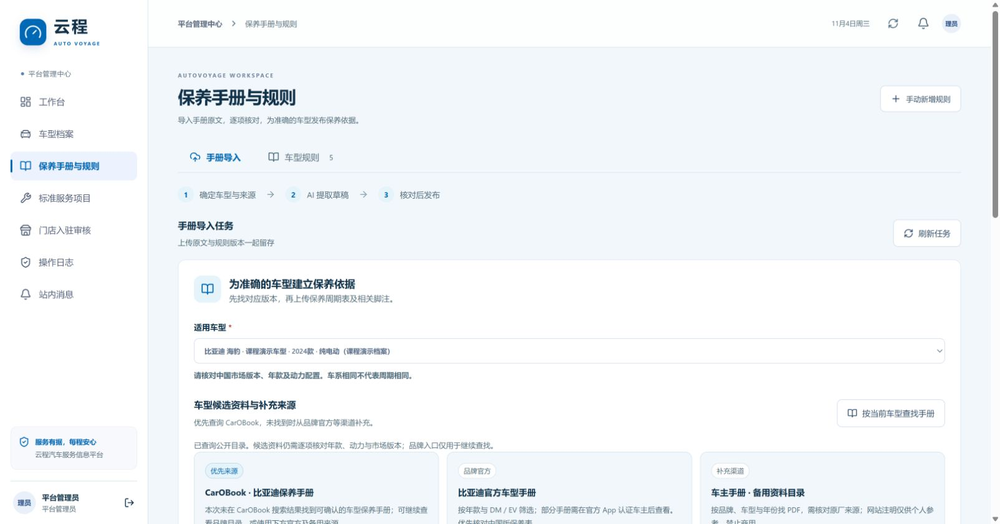

# 云程 · 保养手册采集与 AI 导入

本功能将手册原件、识别草稿与人工复核后的车型规则分开保存。上传或 AI 识别成功不会立即改变车主保养计划，只有平台管理员核对并发布后才供业务使用。实际测试和上线版本见 [验证记录](verification.md)。



## 从哪里取得手册

优先顺序为 **CarOBook 查找 → 车企官方手册补充 → 其他可核实来源 → 人工上传 PDF 或图片**。系统提供来源入口，并对支持的直接 PDF／图片 URL 尝试下载；它不承诺自动获取每个品牌、年款或网盘文件。

| 来源 | 可取得的资料与使用方式 |
| --- | --- |
| [CarOBook 保养手册库](https://www.carobook.com/bysc.html) | 多品牌保养手册目录。具体车型页可能通过百度网盘分享 PDF；这类页面需在浏览器完成获取后上传，不将目录页当作 PDF，也不绕过登录、验证码或下载权限 |
| [比亚迪官方车型手册](https://www.byd.com/cn/user-manual) | 可筛选车型和动力的官方 PDF。部分车型须在官方 App 认证车主后查看 |
| [上汽大众官方保养手册](https://www.svw-volkswagen.com/service/maintenancemanual/) | 上汽大众车型的保养资料；不能用帕萨特资料替代一汽大众迈腾资料 |
| [特斯拉官方车辆保养](https://www.tesla.cn/support/vehicle-maintenance) | 按车型、生产时间及配置区分的保养建议；网页本身不是可直接下载的 PDF |
| [车主手册](https://www.chezhushouce.com/) | 补充查找品牌和年款资料；该站注明仅供个人参考、禁止商用，获取前应检查其使用范围 |

官网和第三方网站可访问，不等于已取得批量抓取或转载授权。导入资料时保留原作者／厂商、来源链接和版次，确认资料适用于当前用途。下载失败或来源受限时，工作区保留人工上传入口，不伪造下载结果。

## 平台管理员操作

1. 登录平台管理账号，进入 **保养手册与规则** 的手册导入工作区，选定具体车型。
2. 核对品牌、车系、年款、动力配置。中国版／海外版、生产适用范围、发动机与变速箱、正常／严苛工况等信息写入“适用范围说明”；不从车名自动推断这些条件。
3. 点击“按当前车型查找手册”，在线查询 CarOBook 公开目录，核对返回的候选资料；未找到或不适用时从官方等补充入口继续查找。默认展示的入口尚未执行在线查找，不代表已找到适用手册。填写手册名称、原始来源 URL、版次，再上传文件或粘贴支持的直接下载地址。
4. PDF 建议只选择保养周期表及其前后脚注页。页码按 **PDF 文件中的页序号，从 1 开始** 填写，例如 `150-154,158`；书页上印刷的页码可能与 PDF 页序号不同，应在说明中写明。
5. 明确同意将选定页面发送至已配置的 AI 服务后开始识别。工作区显示任务状态；可关闭后重新进入查看，不依赖单次浏览器请求保存结果。
6. 逐项对照证据图，修正名称、动作、周期、里程口径、工况和脚注。选择既有标准项目，或明确选择为本条创建新项目；不需要的行取消导入。
7. 保存草稿，勾选已核对车型适用范围与规则内容后发布。发布完成后刷新车型保养项目和车主计划。

普通车主、门店和专家不能上传、编辑或发布平台手册。车主在保养项目或车辆档案中可阅读与本人车辆车型匹配、已发布的手册原件和选定页证据；草稿与未发布附件仅平台管理员可见。被新版规则替代的历史手册仍保留作为服务依据。

## 文件与识别边界

| 项目 | 限制 |
| --- | --- |
| 一次上传 | 1 份 PDF，或最多 12 张 JPEG／PNG／WebP；不能把 PDF 与图片混传 |
| 文件体积 | PDF 最多 32 MiB；图片每张最多 8 MiB；整次上传最多 32 MiB |
| PDF 页数 | 最多 1000 页；每次最多选择 12 页识别，长手册必须明确页码 |
| PDF 图像像素 | 单张及单页图像合计最多 4000 万像素；所选页面累计最多 1.6 亿像素，包含嵌套 Form、软蒙版和图像蒙版。超过预算明确拒绝，可减少选页或降低扫描分辨率 |
| PDF 绘图内容 | 单个解码后绘图流最多 4 MiB；选定页面合计最多 16 MiB；过于复杂的资源图明确拒绝 |
| 页码输入 | 支持逗号及范围；不接受重复、倒序、零、负数或超出原件的页码 |
| 文件内容 | 服务端检查内容并解码；改扩展名不能让无效文件通过 |
| PDF 处理 | 原件受控保存，选定页渲染成图片后识别；不把整本长手册默认发送给 AI |
| 高分辨率扫描 | 常见大于 800 万像素的无蒙版 RGB／灰度 JPEG 先缩至最长边 2000 像素再渲染；最终页图最长边 2000 像素，下载的原始 PDF 不改写 |
| PDF 内联图像 | 当前显式拒绝包含 `BI` 内联图像的 PDF，以免绕过像素预检；可重新导出使用图像 XObject 的标准 PDF，或直接上传保养表图片 |
| 不支持的情况 | 加密／损坏 PDF、不可解码图片、未配置或失败的 AI 服务会明确报错；不生成有效保养规则 |

AI 只读取可见原文，文档或图片中的指令作为资料内容处理。缺失、模糊或未说明的周期保留为 `null`，不能靠通用经验补齐。首次与后续周期分别保存，“没有固定周期”也不能改成零个月或零公里。

## 规则如何表达

| 要素 | 保存方式 |
| --- | --- |
| 动作 | 检查、更换、清洁、润滑或其他；检查不等于强制更换 |
| 周期规则 | 首次月数／公里数、后续月数／公里数独立保存；明确的时间与里程按先到者判断，单一阈值允许另一项为空；正常使用说明放在备注，条件字段为空 |
| 条件／按需规则 | 保留触发条件，不生成固定到期日或固定到期里程；识别候选默认不选中，需管理员核对后明确选入 |
| 里程口径 | 车辆总里程与发动机累计里程区分；没有有效发动机里程时不以车辆总里程替代 |
| 证据 | 原始 PDF／图片、识别页序号、原文摘录、来源、版次及适用范围 |
| 标准项目 | 明确映射有效的周期保养项目，或由管理员确认新增；故障到店诊断不能作为周期保养项目导入 |
| 版本 | 发布保留来源和复核记录；替换既有项目规则时保留旧版本，其他车型不被改写 |

有条件的周期如“在特定路况每年检查”，须采用条件规则保留工况；当前系统不会自动判断该车主是否满足条件，也不会强套固定日期。不能将不同工况和互斥配置无条件合并成所有车主都必须执行的项目。相同标准项目的多种条件需要先核对适用范围，避免在同次导入中重复映射。

## 草稿、发布与失败处理

任务状态为 `uploaded → processing → awaiting_confirmation → published`，识别失败为 `failed`。失败任务可有限重试，最多三次识别尝试；未配置 AI 时不能重试为成功。识别不会自动勾选“已人工核对”。

保存和发布携带草稿版本 `expectedRevision`。其他管理员已修改的任务返回冲突，需重新读取后核对，避免覆盖对方编辑。相同已完成发布请求可安全重试，不重复创建规则或项目；不同内容不能覆写已经发布的任务。

发布在同一事务内验证车型、标准项目、原文证据、周期与确认，创建规则版本、合并车型适用项目并记录审计。任一行失败时整次发布回滚，不出现部分项目已生效的状态。规则发布与手工编辑统一先锁车型再锁规则；跨车型新建标准项目时串行查重。导入规则与被其替代的历史依据不能通过旧规则编辑接口改写或重新激活。

直接 URL 获取仅支持公开 HTTPS；可直接获取 PDF／图片，或从仅包含一个 PDF 下载链接的手册页面继续获取。多个 PDF 的页面需选定具体文件，不自动猜选。内部网络地址、重定向到受限地址、超限或伪装文件会被拒绝。百度网盘等需要交互的分享链接应使用浏览器取得原件后上传。

## 配置与维护

多页手册输出较长，建议将 `AI_TIMEOUT_MS` 设置为 `180000`，并优先选择保养表与必要脚注；真实 7 页样本约需 158 秒。超时后保持失败任务，可减少选页重新上传或有限重试。

复用已有 `AI_BASE_URL`、`AI_API_KEY`、`AI_MODEL`、`AI_API_STYLE` 与 `AI_TIMEOUT_MS`，支持现有 Responses 或 Chat Completions 协议。密钥只在 API 端使用，不发给资料网站或浏览器。数据库新增手册任务表，原件及页图使用现有持久上传目录；部署升级需要同时更新 API 和 Web，保留上传卷。

API 容器建议至少配置 **1 GiB 内存**，PDF 转图和 AI 识别各自串行处理；不能只按压缩文件体积估算解码内存。专项验证中，真实 22,178,816 字节官方手册选取物理页 318–322 成功生成 5 张页图，独立 Windows 进程峰值 RSS 约 570 MiB；34.8 MP 的 600 dpi A4 合成扫描单页成功渲染，独立渲染进程峰值约 505 MiB。RSS 仅用于部署容量参考，平台、PDF 内容及应用其余负载会影响实际内存，像素与内容预算不构成所有 PDF 的固定内存保证。

本地测试使用合成图片、代码生成的 PDF 与本机 AI stub，不包含真实厂商周期或私人证件。测试通过只证明流程、校验和权限，不等于全部车型手册准确率或公网下载均已验证。正式扩充资料库应按品牌、车型年款和动力逐批核对。

专项默认使用内存 PGlite。配置好 `.env` 数据库连接后，可在项目根目录用 PowerShell 执行真实 PostgreSQL 隔离回归：

```powershell
$env:AV_MANUAL_PG_TEST = "1"
try {
  npx tsx --test --test-concurrency=1 apps/api/tests/manuals.test.ts
} finally {
  Remove-Item Env:AV_MANUAL_PG_TEST
}
```

该模式自行创建随机 `av_test_manual_*` schema，并在结束时删除和校验清理结果；不会采用 `.env` 中的业务 schema 运行测试，也不向第三方资料网站或真实 AI 发送请求。
