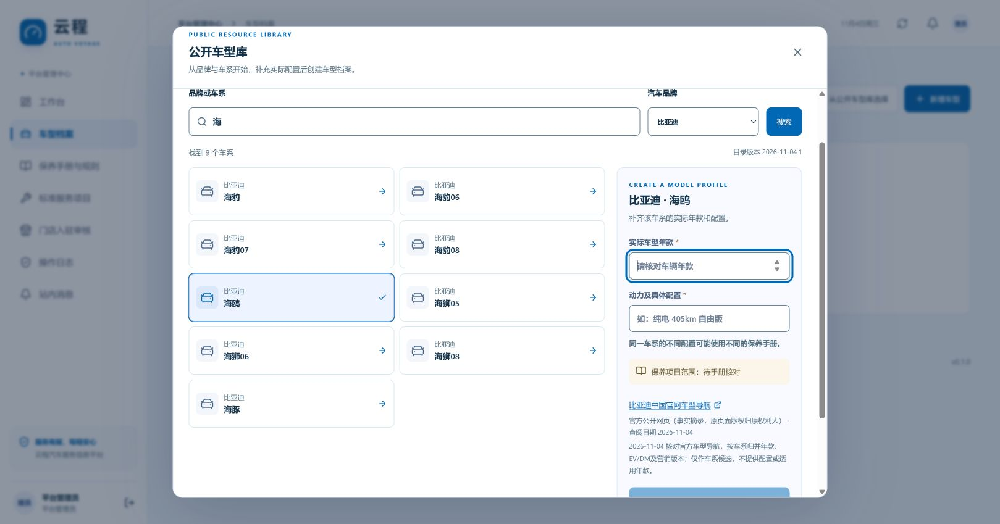
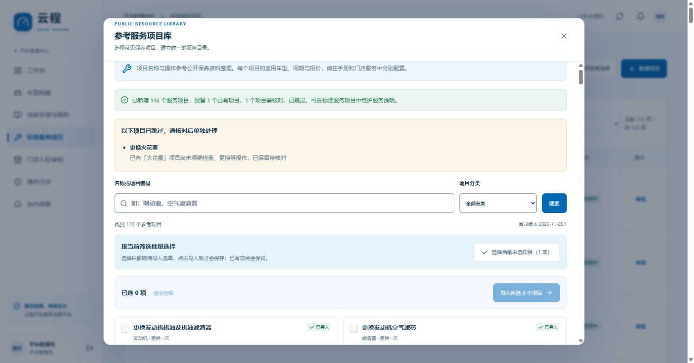

# 公开车型与参考服务项目

系统随应用提供可离线查询的候选目录。平台管理员从目录中选择后，才会将条目加入“车型档案”或“标准服务项目”。候选目录不依赖运行时抓取外站，升级不会覆盖已有档案、规则或门店报价。

车型库包括**品牌／车系候选**及其**有来源的实际年款、动力与配置候选**，并非完整的在售车型或 VIN 数据库。目录版本为 `2026-11-07.1`，历史开源配置、现代车型公开数据与官网补充分别标注来源及日期。总量、收录年款及车系覆盖以目录当前显示为准。数据年代、固定版本及许可见 [来源说明](public-catalog-sources.md)，配置字段与历史来源见 [配置来源说明](vehicle-variants-sources.md)，本次现代车型与比亚迪近期配置见 [现代车型来源](vehicle-variants-modern.md) 和 [比亚迪近期配置来源](vehicle-variants-byd-recent.md)。

## 选择车型

1. 使用平台管理员账号进入 **车型档案 → 从公开车型库选择**。
2. 搜索品牌或车系，可按品牌及**已收录年款**筛选。默认勾选**只看有公开配置的车系**，并将已收录最新年款较新的车系优先显示；卡片列明配置数量与具体收录年份。全局年款选项来自整个目录，不代表每个车系都有该年款。
3. 选择车系，按**已收录车型年款、动力**筛选，再搜索并选择具体配置。若已设置全局年款且该车系收录了该年款，会自动选中；切换全局年款后须重新选择配置。阅读配置名称、厂商（如有）、来源及依据，核对与车辆一致。车型年款不等于登记年份，不能将官网发布日期或手册文件名当作年款。
4. 确认导入。服务端由所选公开配置记录生成档案年款及“动力 · 具体配置”，保存来源与依据；新档案为非演示车型，保养适用范围为“待手册核对”。重复导入同一品牌、车型、年款、动力配置会复用已有档案，不覆盖已有编辑。
5. 进入 **保养手册与规则**，下载或上传匹配该年款和配置的 PDF／图片，完成 AI 草稿核对、原文证据及适用性复核后发布。



截图保留 V0.7；当前界面另有年款、配置及收录范围筛选。**年款未列出表示资料尚未收录，不等于该车型或年款不存在。** 找不到时可按以下入口继续：

- 车系有配置但缺少目标年款：点击**未列出实际年款？手动补充该年款**。若全局年款与所选车系不匹配，预览会说明缺收录，并保留该车系供补充。
- 车系没有配置：关闭**只看有公开配置的车系**，并将全局年款切回全部，选中车系后点击**手动补充年款与配置**，按车辆铭牌或官方配置表填写。
- 筛选无结果：点击**查看全部年款与待补充车系**，清除年款限制并显示资料待补充车系；品牌及关键词继续保留，可按需再调整。
- 当前年款下没有匹配配置：清除动力与关键词筛选，或手动补充当前年款配置。

人工填写模式会带入当前选择的年款供核对；该模式不会添加公开配置 ID 或伪造来源依据。未收录的车系仍可手工新增。手工建档也可先保存未知保养范围，稍后依据手册补齐。

每条公开配置将年款、动力、配置名称与来源依据绑定，不能将不同条目的字段拼成一辆不存在的车型。系统不从车系名称猜测年款或动力，也不把配置库自动转换为车型保养要求。历史数据含停产、进口和商用车型，不表示当年或当前在售状态。

导入后的车型可被车主在添加车辆和行驶证识别确认时选择。公开候选本身不会直接成为车主已选定的保养车型。

## 选择服务项目

参考项目库现提供 **25 项日常通用服务**，用于建立精简的业务目录。范围包括机油与滤清器、火花塞、制动、轮胎、悬架、冷却液、变速器油、蓄电池、雨刮、空调及常见新能源检查；不再列出原目录中大量细分部件检查、清洁和专业维修项目。AT、CVT、DCT 变速器油仍分别列项，不能混用。“通用”表示常见服务类别，具体车型是否适用仍须核对手册。

1. 进入 **标准服务项目 → 从参考项目库选择**。
2. 按名称搜索或按分类筛选，阅读服务描述、动作和来源。
3. 勾选实际需要的项目，或点击**选择当前未选项目**批量选择当前筛选结果中的未导入项目。选择只加入待导入清单，点击导入才保存。检查、更换、清洁等动作分别列项；同一部件的不同动作不能混用，无需为凑齐目录导入全部项目。
4. 导入结果分别显示新增、保留和跳过数量。界面以跳过冲突模式提交：动作未知、名称含义不明确或编码冲突的项目留待核对，成功项目继续导入。阅读页面的项目名称与跳过原因，再单独处理；不要为了补齐数量强行改写已有项目。
5. 返回业务项目列表，默认显示**启用项目**，可切换到**已停用**或**全部项目**。分类、搜索和计数按当前状态范围展示；停用项目仍可查看和编辑恢复。在业务项目中按实际服务边界完善描述和单位；门店通过原有报价流程设置材料、工时和价格。

“标准服务项目”表示本系统统一的项目命名与服务口径。参考库中的简短描述由公开手册内容归纳，不代表国家标准认证、品牌授权或所有车型通用的维修方案。目录不带默认价格、保养周期、材料规格或车型适用关系。项目进入业务目录后，也不会自动成为任何车型的保养要求。

历史记录：V0.8.5 于 2026-11-05 曾从 120 项参考目录选择 118 项，新增 116、复用 1、跳过 1，业务库当时共有 123 项。该数量不是当前精简后的启用数量。“更换火花塞”因已有“火花塞”操作尚未明确而跳过，仍须管理员核对。当前参考库只提供上述 25 项；为兼容既有来源和已保存草稿，服务端保留旧候选 ID。升级镜像本身不会新增或停用已有业务项目。



重复导入优先按候选来源、编码或归一化名称复用；已有同义名称只有在部件相同、操作明确且候选唯一时才复用，保留其编辑、来源和启停状态。例如已有“空调滤清器”且描述明确为更换，可复用“更换空调滤清器”；仅写“火花塞”、动作不明确时不猜测为更换。既有重复记录不在导入时合并或删除。每次成功新增均记录来源快照和审计日志。

接口默认仍为严格模式：任一冲突使整批回滚；前端显式传入 `skipConflicts: true`，只跳过冲突项并展示原因。单次最多200个候选，重复候选ID会去重。具体契约见 [API](api.md#公开车型与参考服务项目)。

## 精简已有服务目录

运维脚本 `scripts/simplify-service-projects.ts` 用于处理此前批量导入的细分项目。默认在只读事务中生成预览，仅显式传入 `--apply` 才停用符合条件的条目。它只处理来源版本为 `2026-11-05.1`、仍与原模板一致、未被人工编辑且无业务引用的非通用项目；原有自定义项目、其他来源版本、重复来源映射、已停用记录及通用项目均保留。

引用检查涵盖当前及历史车型、保养规则、门店报价与历史报价、预约、变更、保养记录、手册任务和草稿快照，包括项目 ID、候选目录 ID 及 `baseRuleVersions` 中的引用。被引用或有编辑审计的项目不会因目录精简而停用。因此业务目录的启用数量可能超过 25，实际结果以预览报告和 [验证记录](verification.md) 为准。

先确认连接目标实例与 schema。根目录 `.env` 可指向开发 schema；本次正式服务为 `public`，在当前 PowerShell 会话设置 `$env:PGSCHEMA='public'` 后运行，不改写开发配置。确认目标后先生成预览：

```powershell
npx tsx scripts/simplify-service-projects.ts --output .local/service-simplification-preview.json
```

报告列出候选完整快照、保留原因、停用前后启用数及计划 `digest`。核对后，将下面的 `DRY_RUN_SHA256` 替换为该摘要，并使用新的报告文件名执行：

```powershell
npx tsx scripts/simplify-service-projects.ts --apply --expect-plan DRY_RUN_SHA256 --output .local/service-simplification-applied.json
```

数据库有多个启用的平台管理员时，预览和执行均须增加 `--actor-id ADMIN_USER_ID`，将 `ADMIN_USER_ID` 替换为真实平台管理员 ID；唯一启用管理员可自动选取。计划发生变化时，摘要校验会拒绝执行，应重新预览。`--help` 可查看完整参数。

应用前脚本先将 `status: prepared` 的恢复快照写入已忽略的 `.local` 目录，数据库事务只将候选 `active` 从 `true` 改为 `false`，逐项记录管理员审计；提交成功后报告标记为 `applied`。不会删除、合并或转移项目，也不修改报价、周期、车型关联或规则。需要恢复时，在**标准服务项目 → 已停用**中编辑对应项目并重新启用，报告中的 `plan.candidates` 保留原始项目快照供核对。若命令异常且报告仍为 `prepared`，先核对数据库实际状态，再决定后续操作。

## 来源与更新

- 每个新导入实体保存候选 ID、目录版本、来源链接、许可说明、资料版本、查阅日期及导入时间。公开配置导入额外保存配置 ID、该行原文依据和可用的厂商信息。
- 官网的公开车系名称仅作事实摘录，不打包官网照片、品牌标志、报价或整份手册。
- 历史开源品牌／车系／配置库保留原项目 MIT 许可及固定提交，不能据其推断当前在售状态；仅保留同一来源行有明确年款、动力、具体配置的记录，缺失或冲突项不自动补值。
- 现代车型公开数据与近期官网补充各保留来源、版本及归属说明；PyLab 数据按原项目 CC BY 4.0 要求署名，具体筛选和转换边界见对应来源文档。不同来源均不能用于推断尚未收录的年款或保养周期。
- 后续更新先核实来源与许可、生成新的候选快照并验证，再随应用发布。不会在用户打开页面时批量爬取第三方网站。

平台候选目录及导入接口只向平台管理员开放；车主、门店和专家沿用已建档的车型与服务目录。

## 验收建议

使用隔离的测试数据验证：按品牌／关键字查询及分页、填写年款与动力、导入后来源可追溯、重复导入不覆盖、参考服务只列 25 项通用候选、按当前筛选批量选择、同义项目复用、未知动作和歧义跳过、严格模式冲突整批回滚、启用／停用／全部状态下的分类筛选与计数、停用项目编辑恢复、重复并发请求、无权限访问被拒绝、未知保养范围显示待补充。精简脚本还应验证默认只读、摘要变化拒绝、来源版本及人工编辑保护、历史引用和手册草稿保护、失败回滚与快照保存。随后选择适用手册走完审核发布，确认只影响目标车型。

配置专项还应检查：全局已收录年款过滤、默认只看有配置车系、最新年款优先排序、卡片年份与实际配置一致、按年款及动力过滤、配置名称搜索、无配置时人工补充、所选车系缺目标年款时的说明与预填、快速切换全局年款不会沿用旧配置、来源依据保留、跨车系配置与夹带年款／动力覆盖被拒绝、所选配置的并发重复导入只创建一份档案。接口及共享字段见 [API](api.md#公开车型与参考服务项目)。

后端专项测试默认使用内存 PGlite。真实 PostgreSQL 专项通过 `AV_CATALOG_PG_TEST=1` 启用，只在随机 `av_test_catalog_*` schema 中操作并在结束后清理，不写公共业务表。实际执行结果见 [验证记录](verification.md)。
