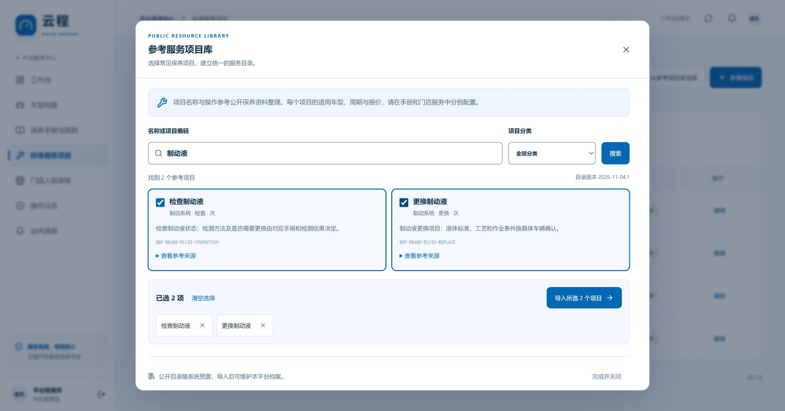

# 公开车型与参考服务项目

系统随应用提供可离线查询的候选目录。平台管理员从目录中选择后，才会将条目加入“车型档案”或“标准服务项目”。候选目录不依赖运行时抓取外站，升级不会覆盖已有档案、规则或门店报价。

车型库包括**品牌／车系候选**及其**有来源的实际年款、动力与配置候选**，并非完整的在售车型或 VIN 数据库。目录版本为 `2026-11-04.2`，历史开源配置与官网补充分别标注来源及日期。历史部分保留 29,169 条明确年款为 1999–2019 的配置；官网配置逐项核对补充，总量及车系覆盖以目录当前显示为准。数据年代、固定版本及许可见 [来源说明](public-catalog-sources.md)，配置字段与具体来源见 [配置来源说明](vehicle-variants-sources.md)。

## 选择车型

1. 使用平台管理员账号进入 **车型档案 → 从公开车型库选择**。
2. 搜索品牌或车系，或按品牌筛选，查看条目出处及数据年代。
3. 选择车系，查看已有配置数量；按**车型年款、动力**筛选，再搜索并选择具体配置。阅读配置名称、厂商（如有）、来源及依据，核对与车辆一致。车型年款不等于登记年份，不能将官网发布日期或手册文件名当作年款。
4. 确认导入。服务端由所选公开配置记录生成档案年款及“动力 · 具体配置”，保存来源与依据；新档案为非演示车型，保养适用范围为“待手册核对”。重复导入同一品牌、车型、年款、动力配置会复用已有档案，不覆盖已有编辑。
5. 进入 **保养手册与规则**，下载或上传匹配该年款和配置的 PDF／图片，完成 AI 草稿核对、原文证据及适用性复核后发布。

截图保留 V0.7；本次在选择车系后增加实际配置筛选。没有找到匹配的公开配置时，使用人工填写模式，依据车辆资料补充年款与动力配置；该模式不会添加公开配置 ID 或伪造来源依据。未收录的车系仍可手工新增。手工建档也可先保存未知保养范围，稍后依据手册补齐。

每条公开配置将年款、动力、配置名称与来源依据绑定，不能将不同条目的字段拼成一辆不存在的车型。系统不从车系名称猜测年款或动力，也不把配置库自动转换为车型保养要求。历史数据含停产、进口和商用车型，不表示当年或当前在售状态。

导入后的车型可被车主在添加车辆和行驶证识别确认时选择。公开候选本身不会直接成为车主已选定的保养车型。

## 选择服务项目

1. 进入 **标准服务项目 → 从参考项目库选择**。
2. 按名称搜索或按分类筛选，阅读服务描述、动作和来源。
3. 勾选需要的项目后批量导入。检查、更换、清洁、润滑等动作分别列项；同一部件的不同动作不能混用。
4. 在业务项目中按实际服务边界完善描述和单位；门店通过原有报价流程设置材料、工时和价格。

“标准服务项目”表示本系统统一的项目命名与服务口径。参考库中的简短描述由公开手册内容归纳，不代表国家标准认证、品牌授权或所有车型通用的维修方案。目录不带默认价格、保养周期、材料规格或车型适用关系。项目进入业务目录后，也不会自动成为任何车型的保养要求。

重复导入会复用同编码或同名称的既有项目，保留其编辑和启停状态。编码与已有项目名称冲突时，整批导入失败并提示先核对，避免部分写入。每次成功新增均记录来源快照和审计日志。

## 来源与更新

- 每个新导入实体保存候选 ID、目录版本、来源链接、许可说明、资料版本、查阅日期及导入时间。公开配置导入额外保存配置 ID、该行原文依据和可用的厂商信息。
- 官网的公开车系名称仅作事实摘录，不打包官网照片、品牌标志、报价或整份手册。
- 历史开源品牌／车系／配置库保留原项目 MIT 许可及固定提交，不能据其推断当前在售状态；仅保留同一来源行有明确年款、动力、具体配置的记录，缺失或冲突项不自动补值。
- 后续更新先核实来源与许可、生成新的候选快照并验证，再随应用发布。不会在用户打开页面时批量爬取第三方网站。

平台候选目录及导入接口只向平台管理员开放；车主、门店和专家沿用已建档的车型与服务目录。

## 验收建议

使用隔离的测试数据验证：按品牌／关键字查询及分页、填写年款与动力、导入后来源可追溯、重复导入不覆盖、多个项目批量导入、重复并发请求、无权限访问被拒绝、未知保养范围显示待补充。随后选择适用手册走完审核发布，确认只影响目标车型。

配置专项还应检查：按年款及动力过滤、配置名称搜索、无配置时人工补充、来源依据保留、跨车系配置与夹带年款／动力覆盖被拒绝、所选配置的并发重复导入只创建一份档案。接口及共享字段见 [API](api.md#公开车型与参考服务项目)。

后端专项测试默认使用内存 PGlite。真实 PostgreSQL 专项通过 `AV_CATALOG_PG_TEST=1` 启用，只在随机 `av_test_catalog_*` schema 中操作并在结束后清理，不写公共业务表。实际执行结果见 [验证记录](verification.md)。
