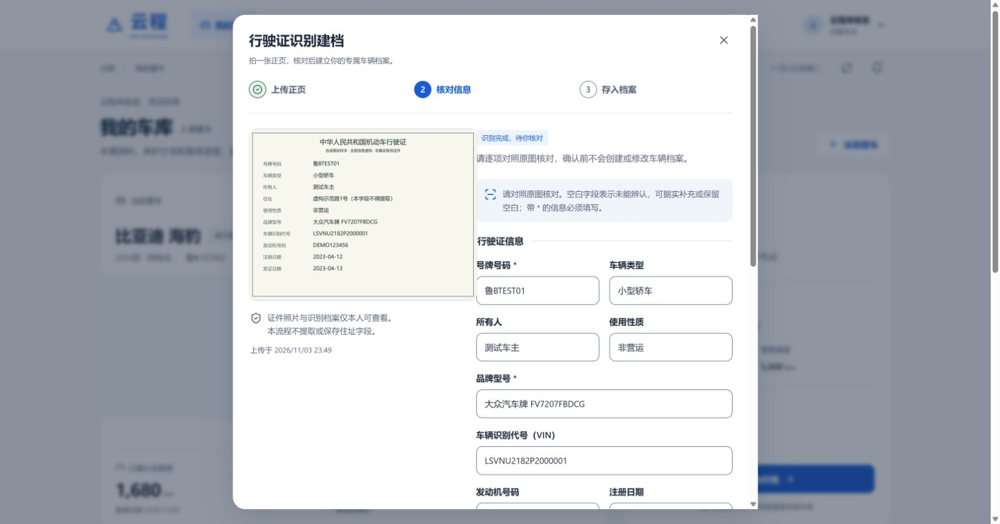

# 云程 V0.3 · 用户操作与课堂演示手册

云程是中国海洋大学 MEM《软件工程管理》课程的汽车信息管理系统，覆盖车主建档、养护提醒、门店比价预约、故障咨询和服务归档。

课程预览入口：[http://117.72.124.241:58083/](http://117.72.124.241:58083/)。本文同步 V0.3 视觉与地图调整，并保留原有建档和服务流程。具体线上应用版本、检查结果与待验收项见 [验证记录](verification.md)，文档提交本身不会自动发布 Portainer 镜像。

## 1. 登录与角色入口

四种角色共用同一登录页，输入分配给自己的邮箱和密码，点击“登录云程”。登录后按账号角色显示车主页面或管理工作台，不需要另找管理地址。公网账号口令由部署负责人单独分发，不在 GitHub 文档中公开。

| 角色 | 主要入口 | 可以完成的工作 |
| --- | --- | --- |
| 车主 | 我的爱车、附近门店、故障咨询、消息中心、我的服务 | 管理本人车辆、识别行驶证和里程图片、查看保养计划、比价预约、确认服务变更与完工 |
| 门店管理员 | 工作台、预约与工单、故障咨询、服务与价格、预约时段、服务档案、门店资料 | 维护本店服务与名额、接单、提出变更、分配专家、处理服务与提交完工 |
| 专家 | 专家服务工作台、预约与工单、故障咨询、服务档案 | 在服务端允许的本店及分配范围内处理事项，回复分配给自己的故障咨询 |
| 平台管理员 | 车型档案、保养手册与规则、标准服务项目、门店入驻审核、操作日志 | 维护车型与适用项目、规则来源、服务目录和门店审核 |

手机端车主底部导航对应“爱车、找店、报修、消息、我的”；桌面端“我的服务”对应手机端“我的”。门店、专家和平台账号均不能读取车主私人行驶证照片与识别档案。

## 2. 用行驶证建立新车辆档案

### 2.1 选择照片并识别

1. 在“我的爱车”点击“添加爱车”，选择“行驶证识别建档”。也可在“我的服务 → 车辆档案 → 添加车辆”进入。
2. 点击“选择行驶证正页照片”，选择一张 JPG / JPEG、PNG 或 WebP 图片，文件最大 8 MB。照片应四角完整、文字清晰，避免反光、遮挡和水印。
3. 阅读并勾选将本张照片发送至已配置 AI 服务的同意说明，点击“上传并识别行驶证”。
4. 等待状态变为“识别完成，待你核对”。上传和识别阶段只产生任务，不创建车辆。

本流程不提取或保存住址字段。**上传的原图仍可能包含住址**，系统不会自动遮挡原图；可在上传前遮住住址等无关信息，同时保留要识别的车辆字段。证件照片经本人同意后会发送至后端配置的 AI 服务。

### 2.2 对照原图核对九项信息

| 字段 | 核对要求 |
| --- | --- |
| 号牌号码 | 必填，核对每个汉字、字母和数字 |
| 车辆类型 | 据原图填写；未显示可留空 |
| 所有人 | 据原图填写；未显示可留空 |
| 使用性质 | 据原图填写；未显示可留空 |
| 品牌型号 | 必填，保留证件上的品牌型号原文 |
| 车辆识别代号（VIN） | 可留空；填写时为 17 位字母与数字，不含 I、O、Q |
| 发动机号码 | 据原图填写；未显示可留空 |
| 注册日期 | 可留空；据实填写，不得在未来 |
| 发证日期 | 可留空；不得在未来，填写两种日期时不能早于注册日期 |

识别结果可逐项修改。可选字段无法辨认时可以留空，不要为了通过表单编造信息。识别和存档不等同于对证件真伪、车辆权属的官方认证。

### 2.3 补全车辆信息并确认

新车还需要车主单独填写以下内容：

- **保养车型配置**：明确核对汽车品牌、年款和动力配置后选择。行驶证的“品牌型号”常是车辆型号代码，系统不会据此猜测保养车型。列表没有匹配配置时联系平台补充，不能选择相近车型。
- **车辆昵称**：便于自己区分爱车。
- **车辆启用日期**与**启用时里程（km）**：据实独立填写，不会自动使用注册日期或发证日期代替。

对照原图完成核对后，勾选“我已对照原图核对以上信息，确认属于本人的车辆，并同意保存到车辆档案”，再点击“确认信息并建立车辆档案”。保存成功后点击“回到车辆档案”查看。

行驶证不包含当前总里程，本流程不会生成当前里程观测。启用时里程是单独输入的建档基准，当前里程需通过仪表或车厂应用截图核对更新。

下图为公网验收时使用的**明确标记为虚构的合成样本**核对页，未提交建档确认，也未创建公共测试车辆：

## 3. 给已有车辆补充行驶证

1. 打开“我的服务 → 车辆档案”，找到对应车辆，点击“上传行驶证并识别”。
2. 上传正页，勾选 AI 识别同意说明，识别后逐项核对。
3. 确认号牌与当前车辆一致，勾选核对说明，点击“确认并保存行驶证档案”。

补充证件只保存到本人私人档案，不改写车辆的保养车型、启用日期、初始里程或当前里程。若原车辆车牌录入有误，应先通过车辆修改入口明确更正，再上传匹配的行驶证。

已有确认档案时可查看九项信息、查看本人原图，或通过“上传新的行驶证”补充新照片。车辆卡片的汽车插画仅为示意，真实车牌与配置以档案文字为准。

## 4. 离开后继续任务与失败处理

关闭识别窗口不会取消已上传的任务。进入“我的服务 → 车辆档案”，在“行驶证识别记录”点击“查看任务”，或在车辆卡片点击“继续行驶证识别任务”，即可继续处理。新车任务在确认前不会出现在车库中。

| 界面情况 | 处理方法 |
| --- | --- |
| 上传按钮不可用 | 检查是否选择有效图片、勾选本张照片的识别同意说明，以及识别服务是否可用 |
| 图片格式或体积不合要求 | 转为真实 JPG、PNG 或 WebP 并压缩至 8 MB 内；仅改文件扩展名无效 |
| “这次未能完成识别” | 确认是清晰正页，可点击“使用原图重新识别”或“换一张照片”；任务最多三次识别尝试 |
| 识别完成但信息错误 | 在核对页据原图修改；无法判断则“重新选择照片” |
| 号牌与已有车辆不一致 | 检查选中的车辆和原图；不要把其他车辆证件保存到当前车辆 |
| VIN 或日期被拒绝 | 核对 VIN 的 17 位规则和日期先后关系，不用猜测值填补空白 |
| 同一车主已有相同号牌 | 返回现有车辆补充证件，不重复新建车辆 |
| 没有匹配的保养车型 | 联系平台维护对应年款和动力配置，不能选择近似车型完成建档 |
| AI 服务暂不可用 | 由部署负责人检查服务配置；也可先通过“手动填写车辆信息”建档，稍后补充证件 |

## 5. 更新当前里程与查看养护计划

行驶证识别与里程识别是两个入口，使用不同照片、确认不同数据。

1. 在“我的爱车”选中车辆，点击“更新里程”。
2. 选择仪表照片或车厂应用截图，选择相应图片类型，点击“上传并识别”。
3. 对照原图核对**总里程**、原图单位和**图片数据时间（北京时间）**；单次行程 TRIP、续航 RANGE 不能当作累计总里程。数据时间应是读数实际对应的时间。
4. 原图明确显示发动机累计里程时才填写该值，不能用车辆总里程代替。
5. 点击“已核对，确认更新”，通过质量校验后才更新有效观测与保养计划。

识别失败、未确认、旧图、重复图、未来时间和里程回退不会静默覆盖此前有效里程。保养计划按车型适用项目计算，时间或里程任一阈值先到为准；演示规则均有标识，不能直接作为真实车辆保养依据。

V0.3 首页、登录页与车辆档案采用统一风格的**原创 SVG 汽车示意插画**，不再展示真实车型照片。插画不是具体车型、年款或车主实车的精确还原；车辆品牌、年款、动力和保养配置以档案文字为准。V0.2 历史照片的来源和许可仍保留在 [素材说明](image-attribution.md)。

## 6. 从门店比价到服务归档

### 车主选择与预约

在“附近门店”选择车辆、服务日期和保养项目，可结合列表、地图与筛选比较门店。比较时核对材料规格、包含与排除范围、税费和报价类型，不能把不同方案只按显示金额比较。

地图蓝点表示本次搜索中心，编号对应当前门店列表；点击门店编号可选中该店，点击地图可调整搜索中心。V0.3 默认使用 OpenFreeMap 提供的真实 OSM 矢量底图，保留地图来源署名；界面显示加载状态，加载失败或超时会给出提示与“重试”。地图需要浏览器支持 WebGL，并能连接公开地图服务；暂不可用时仍可按门店地址和列表查询。公共 IP 的 HTTP 预览通常无法使用浏览器定位，可通过搜索参考位置手选中心；定位与底图加载是两项独立能力。

点击“查看项目明细与预约”，在“确认这一程的服务”核对完整固定报价与时段，勾选确认说明后点击“确认全部项目并提交预约”。查看报价不预留名额，提交时会重新核验价格版本、有效期、车辆冲突和剩余名额。预估区间、需询价或缺项组合不能作为确定总价直接预约。

提交后状态为“待门店确认”，在“我的服务 → 我的预约”查看进度；待接单以及已接单但尚未开始服务时，可通过“取消预约”填写原因并确认取消。

### 门店接单与完工

门店账号打开“预约与工单”，查看车辆、时段和原报价快照，依次处理“确认接单”“开始服务”。如需调整项目、材料或费用，通过“提出费用变更”填写变更后的完整服务范围和订单总额，发送给车主确认。

车主在预约详情核对变更说明、项目与费用，决定接受或拒绝。未获确认的变更不能作为已批准服务；存在待确认变更时不能直接提交完工。

服务后门店“提交完工”，选择实际完成项目并填写完工时总里程。车主收到通知后，在预约详情“核对并确认完工”，核对实际项目、费用和里程，再“确认完工并归档”。系统只对车主最终确认的实际完成项目更新保养基准，历史记录可在“养护档案”查看。

## 7. 故障咨询与专家协作

车主在“故障咨询”（手机“报修”）选择本人车辆和门店，填写现象、发生条件与时间，可上传相关故障照片，点击“提交给门店专家”。不要把私人行驶证作为共享故障照片。

门店在“故障咨询”分配本店专家；专家查看分配事项，选择“回复建议”，给出初步建议与预估，或要求补充资料。车主可以“发送补充信息”，收到回复后先阅读不确定因素与费用范围，再“确认已理解服务范围”并查看该店服务与时段。

专家图文回复是初步建议，预估金额不等于确定维修报价。到店诊断固定费用不包含后续维修总价，实际维修项目和费用仍需另行确认。

## 8. 平台维护顺序

平台管理员可在“标准服务项目 → 从参考项目库选择”多选导入常见保养项目，在“车型档案 → 从公开车型库选择”搜索品牌与车系，填写实际年款、动力和配置后建档。目录随应用预置，每项保留出处；历史品牌／车系数据标明年代，未找到的条目仍可手工新增。完整操作与覆盖边界见 [公开目录](public-catalog.md)。

新车型可以先保存为“保养范围待手册核对”。随后取得匹配该年款与动力配置的手册，在“保养手册与规则”核对 AI 草稿、原文证据和适用性后发布。参考项目和车系名称不会自动生成保养周期、适用关系或门店报价。重复导入保留已有档案和编辑。

通过“门店入驻审核”核对门店资料、坐标与资质；门店通过审核后再由本店管理员维护“服务与价格”“预约时段”。新价格发布使用版本，已预约订单保留原价格快照。重要维护记录可在“操作日志”查看。

## 9. 五分钟课堂演示建议

演示前准备隔离的本地课程环境、四角色账号、清晰的虚构行驶证与仪表样本，以及可预约的演示门店和未来时段。公开预览适合展示页面与待确认识别；需要写入预约和完成整个闭环时优先使用隔离环境。

| 时间 | 演示动作 | 要说明的设计点 |
| --- | --- | --- |
| 0:00–1:00 | 车主首页展示数字车库与汽车示意插画、切换燃油与纯电车辆、查看保养计划 | 示意图与档案分开、车型适用范围、有效里程来源 |
| 1:00–2:00 | 添加爱车，上传虚构行驶证，展示九字段核对和车型选择 | AI 只给候选，确认前不建档；注册日期与启用基准分开 |
| 2:00–3:00 | 展示门店同口径比价、项目与价格明细、提交预约 | 固定价快照、名额与价格版本校验 |
| 3:00–4:00 | 门店接单、开始服务，展示费用变更与车主决定 | 跨角色协作和明确确认 |
| 4:00–5:00 | 门店提交实际完成项目，车主确认归档，再展示服务记录 | 只重算已确认完成项目，保留历史依据 |

可预先准备一个“待车主确认完工”的演示工单，避免现场操作占用全部时间；不要把尚未现场执行的步骤写成验收通过。六人责任划分见 [开发与验收](development.md)。

## 10. 当前验证范围

历史 V0.2 的本地完整检查包含 27 项后端测试及前后端构建；新增行驶证测试另在隔离 PostgreSQL schema 验证。该版本公网曾验证实拍图片和使用虚构样本的真实 AI 行驶证识别，云端合成识别任务保留待确认，未创建公共测试车辆。V0.3 的 SVG 视觉与地图改动须按验证记录单独检查，不能直接沿用此前截图作为新版结果。

上述结果证明已配置服务与应用流程接通，不能推断私人证件、模糊、反光、旋转及各种版式的准确率。真实手机浏览器、HTTPS 与定位能力、真实车型手册和性能指标的验收范围，以 [验证记录](verification.md) 为准。部署方式见 [部署说明](deployment.md)，接口字段见 [API 文档](api.md)。
