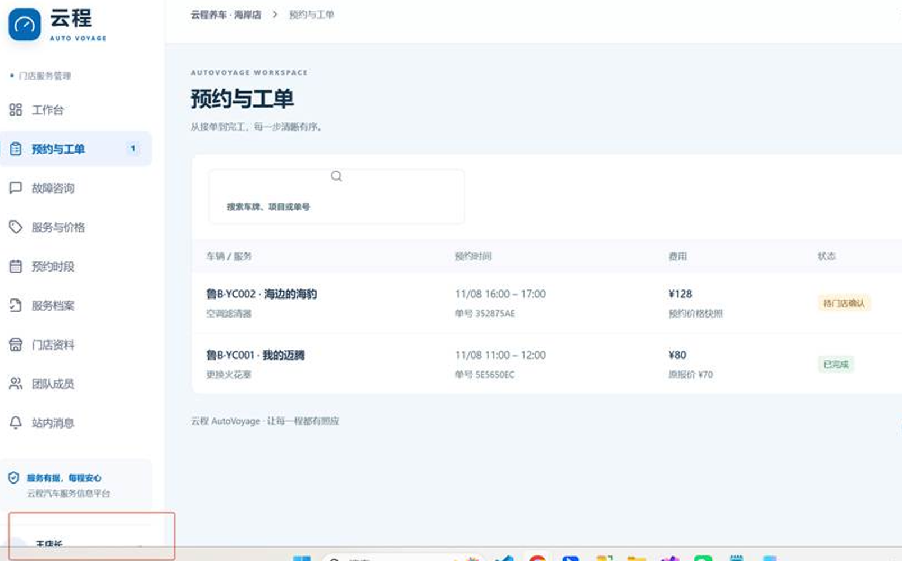
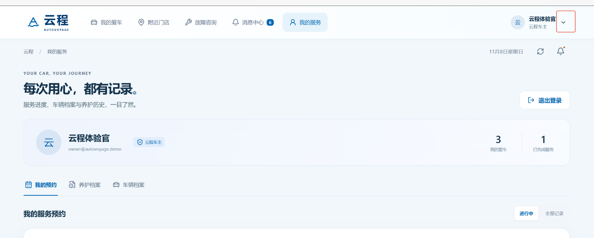

# 车行无忧 测试问题清单

> 来源：《车行无忧-测试报告.docx》（2026-11），按模块分组，保留原文描述；第三节为后续补充的需求与适配问题。

## 一、车主账号

### 我的爱车

1. 概念车照片与实车照片不符，点击“3D概念车 外观示意”会进入一个无关网页；方案：删除跳转逻辑。
2. “我的爱车”后面多一条横线；方案：删除横线
3. 这一块占用位置偏大，建议缩小，将下方的上传照片的框图放大；方案：按照建议处理
4. 点击通知的消息后，会自动弹回到主页面；页面左上角有一个通知，下方第四个 sheet 也是通知，两者重复。暂不处理。

### 找店

1. 点击“搜索门店名称、地址”时，页面会自动放大，退出输入法时，不会自动缩小；问题分析：应该是手机兼容性问题，制定解决方案
2. “本次服务项目”只能在已有选项中选择，无法手动输入其他服务项目。方案：允许手动输入其他服务项目

### 我的

1. “退出登录”按钮无再次确认按钮，易被误触。方案：增加确认弹框，确认后退出。

### 门店

1. 团队成员页面，无新增/删减成员选项；方案：增加新增/删减成员选项
2. 此处显示不全；（门店角色-左侧菜单栏-底部-服务有据、每程安心这个菜单遮挡了，没展示全）方案：调整一下，要展示全。
3. 店主也能回复车主的故障咨询，但页面显示是专家答复的。

## 二、后台

1. AI 查找出的保养手册没有自动保存。方案：希望可以被保存，下次可以直接展示出已经查找过的保养手册。

## 三、需求与适配问题（补充）

1. FR-01、保养手册与规则需要手工填写入口，或直接选择标准服务项目（共性问题，多处信息无填写入口）；方案：按要求修改
2. FR-18、里程更新 需要手工填写入口；方案：按要求修改
3. FR-23、历史保养记录 需要手工填写入口；方案：按要求修改
4. PC 网页端门店 ui 定位不适配（菜单展示不全时应该可以滚动，进行查看）。具体位置：门店端页面左侧菜单栏底部展示不全，当前用户信息（“王店长”卡片）被页面底边截断，无法查看和操作，见截图红框。

   方案：展示完全

5. PC 网页端右上角的下拉按钮可以去掉（顶栏用户信息“云程体验官”右侧的下拉箭头按钮，见截图红框）。方案：去掉下拉箭头按钮

   
